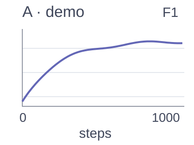

---
cssclasses:
  - research
---
此页演示插图的全部排版：单图三种对齐、1–4 列多图组、一大多小，以及在笔记里直接拖动调整。全部图片为程序生成的示例图，不代表真实实验结果。

# 两列与多行

> [!figure|grid-2] 图 1 · 五张图片按两列排列
> ![[assets/compact-1.svg]]
> ![[assets/compact-2.svg]]
> ![[assets/compact-3.svg]]
> ![[assets/compact-4.svg]]
> ![[assets/compact-5.svg]]

# 四列与多行

> [!figure|grid-4] 图 2 · 六张图片按四列排列
> ![[assets/compact-1.svg]]
> ![[assets/compact-2.svg]]
> ![[assets/compact-3.svg]]
> ![[assets/compact-4.svg]]
> ![[assets/compact-5.svg]]
> ![[assets/compact-6.svg]]

# 左对齐单图

> [!figure|left] 图 3 · 小图保持原有宽度与比例
> ![[assets/curve-6.svg|320]]

# 右对齐单图

> [!figure|right] 图 4 · 右对齐，宽度写在链接里
> ![[assets/curve-3.svg|360]]

# 一大多小

第一张是大图。`mosaic-left` 大图在左，`mosaic-right` 大图在右；三张就是一大两小，小图的张数不限。可用宽度不超过 520px 时全部竖排。

> [!figure|mosaic-left] 图 5 · 大图在左，右侧两张细节
> ![[assets/curve-4.svg]]
> ![[assets/compact-2.svg]]
> ![[assets/compact-3.svg]]

> [!figure|mosaic-right] 图 6 · 大图在右，左侧三张细节
> ![[assets/curve-1.svg]]
> ![[assets/compact-4.svg]]
> ![[assets/compact-5.svg]]
> ![[assets/compact-6.svg]]

# 单列与原生图片链接

`grid-1` 每行一张。图片也可以用 Markdown 原生的 `` 写法：

> [!figure|grid-1] 图 7 · 单列排列，两种链接写法混用
> ![[assets/curve-2.svg]]
> 

# 在笔记里调整

鼠标移到任意一张插图上，右上角出现工具条：拖动右下角的圆点调整宽度，拖动左上角的手柄改对齐或换位置，工具条上可以切换 1–4 列和「大图在左 / 大图在右」。所有修改都直接写回上面的 Markdown。
